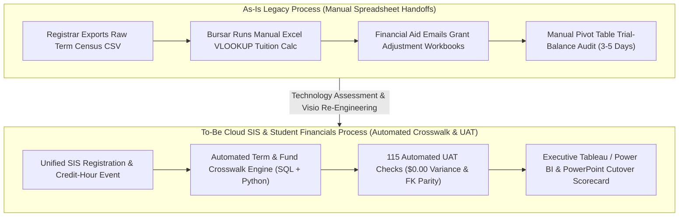

# Visio BPMN 2.0 Business Process Mapping & Stakeholder Interview Synthesis Guide

## 1. Qualitative Stakeholder Interview & Institutional Culture Matrix

| Functional Unit | Key Stakeholders Interviewed | As-Is Legacy Process & Cultural Friction | To-Be Cloud SIS / Financials Workflow | UAT & Cutover Readiness Gate |
| :--- | :--- | :--- | :--- | :--- |
| **Office of the University Registrar** | Associate Registrar, Scheduling Leads | Disconnected course-registration census extracts and manual term-rollover spreadsheets (`18+ hrs/week`). | Standardized academic-period hierarchy (`AY2025-26_FALL`) with automated census snapshot locking. | 100% credit-hour parity across all academic units. |
| **Student Financials & Bursar** | Director of Student Accounts, Analysts | Manual Excel `VLOOKUP` reconciliation between credit-hour loads and tuition fee tables. | Automated rule-driven tuition calculation engine with real-time GL chart-of-accounts mapping. | `$0.00` tuition and fee variance across 250,400+ rows. |
| **Financial Aid & Scholarships** | Compliance Officers, Aid Counselors | Delayed batch synchronization between federal/institutional grants and student billing statements. | Event-driven disbursement posting with automated pending-aid credit validation. | Zero duplicate or unlinked disbursement IDs in UAT. |
| **Institutional Research & FP&A** | BI Leads, Budget Analysts | Fragmented definitions of full-time equivalent (FTE) enrollment and net tuition revenue across colleges. | Unified star-schema reporting layer feeding Tableau, Power BI, and executive PowerPoint scorecards. | 48% reduction in end-of-term reporting cycle time. |

---

## 2. As-Is vs. To-Be Business Process Flow (Microsoft Visio BPMN 2.0 Swimlane Specification)

